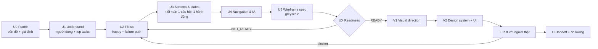

# UX-First Workflow: UX trước, UI sau

Playbook cho designer và AI collaborator (Claude, Claude Design, Codex...).
Mục tiêu: quyết định **trải nghiệm làm gì, theo thứ tự nào** trước khi quyết định **trông như thế nào**.

> Quy tắc vàng: chưa có screen inventory và verdict UX Readiness thì chưa bàn màu, font, vibe.

## Bản đồ quy trình



## Từng bước

| Bước | Câu hỏi phải trả lời | Output (template) | Skill phụ trách | Cổng qua bước |
|---|---|---|---|---|
| U0 Frame | Vấn đề thật là gì, đo bằng gì, giả định nào nguy hiểm nhất? | [problem-statement](skills_UIUX/templates/ux/problem-statement.md), [assumption-map](skills_UIUX/templates/ux/assumption-map.md) | `product-discovery` | Có outcome metric (hoặc UNKNOWN) + 1 giả định rủi ro nhất |
| U1 Understand | Ai dùng, việc gì quan trọng nhất? | [proto-persona](skills_UIUX/templates/ux/proto-persona.md), [jtbd-and-top-tasks](skills_UIUX/templates/ux/jtbd-and-top-tasks.md) | `audience-intent-and-top-tasks`, `ux-research-and-journey` | 3 đến 5 top tasks có JTBD + scenario |
| U2 Flows | Đi từ đâu tới đâu, hỏng thì sao? | [user-flow](skills_UIUX/templates/ux/user-flow.md), [task-flow](skills_UIUX/templates/ux/task-flow.md) | `ux-structure-and-flow-design` | Mỗi top task có happy path + failure path có recovery |
| U3 Screens & states | Mỗi màn trả lời câu hỏi gì, hành động chính là gì? | screen inventory trong skill | `ux-structure-and-flow-design`, `state-feedback-and-error-recovery` | Không màn nào thiếu primary action hoặc recovery |
| U4 Navigation & IA | Cấu trúc điều hướng nào hợp tần suất task? | [ia-sitemap](skills_UIUX/templates/ux/ia-sitemap.md) | `information-architecture` | Model điều hướng có lý do, nhãn dùng ngôn ngữ người dùng |
| U5 Wireframe | Nội dung xếp theo ưu tiên nào? | [wireframe-spec](skills_UIUX/templates/ux/wireframe-spec.md) | `ux-structure-and-flow-design` | Greyscale, nội dung thật, có trạng thái empty/error |
| Gate | Đủ chắc để vẽ visual chưa? | [UX Readiness gate](skills_UIUX/ux-structure-and-flow-design/checklists/ux-readiness-gate.md), [heuristic-evaluation](skills_UIUX/templates/ux/heuristic-evaluation.md) | `ux-structure-and-flow-design`, `ux-laws-and-heuristics` | 0 blocker mở, verdict READY hoặc READY_WITH_RISKS |
| V1 Visual direction | Ngôn ngữ thị giác nào phục vụ đúng task và brand? | design decision v2 | `visual-design-direction` | So sánh 2 hướng trên cùng nội dung và state |
| V2 Design system + UI | Token, component, state đầy đủ chưa? | tokens + components | `design-system-and-components` | Không làm mất recovery hay hạ cấp primary action của UX |
| T Test | Người thật có làm được không? | [usability-test-plan](skills_UIUX/templates/ux/usability-test-plan.md) | `moderated-usability-testing` | Finding có session ID, không bịa quote |
| H Handoff + đo | Đã tốt hơn chưa, đo thế nào? | [design-rationale](skills_UIUX/templates/ux/design-rationale.md), [ux-scorecard](skills_UIUX/templates/ux/ux-scorecard.md) | `design-critique-and-rationale`, `ux-benchmarking-and-metrics` | Scorecard so sánh cùng task, cùng phương pháp |

## Prompt ngắn cho Claude (chat / Claude Code)

Dán đầu mỗi phiên:

```text
Dùng repo uiux-ai-workspace. Đọc UX-FIRST-WORKFLOW.md và skills_UIUX/ux-structure-and-flow-design/SKILL.md.
Sản phẩm: <1 câu>. Người dùng: <ai>. Bối cảnh: <thiết bị, thời gian, mạng>.
Làm U0 tới U5 + UX Readiness. Chưa bàn visual. Giả định thì ghi HYPOTHESIS.
```

Prompt từng bước (thay phần trong ngoặc):

| Bước | Prompt |
|---|---|
| U1 | `Xếp hạng top tasks theo tần suất x hậu quả, viết JTBD + scenario cho top 3.` |
| U2 | `Vẽ user flow Mermaid cho task <X>: happy path, 1 alt path, 2 failure path có recovery. Đếm bước.` |
| U3 | `Lập screen inventory: entry state, user question, info priority, primary action, destination, feedback, recovery.` |
| U5 | `Viết wireframe spec cho màn <Y>, nội dung tiếng Việt thật, greyscale, đủ empty/error/loading.` |
| Gate | `Walkthrough 5 scenario khác nhau (lần đầu, vội, lỗi, chữ lớn, nội dung dị). Ra verdict UX Readiness.` |
| Critique | `Critique theo thứ tự goal → flow → hierarchy → content → interaction → visual. Phân loại blocker/improvement/preference.` |

## Prompt ngắn cho Claude Design

Claude Design mạnh nhất khi nhận **cấu trúc đã quyết** thay vì một câu mô tả mơ hồ.

**Bước wireframe (trước visual):**

```text
Greyscale wireframe, 1 font, không màu brand. Màn <tên>, mobile 390.
Thứ tự nội dung: 1) <...> 2) <...> 3) <...>. Primary: "<nhãn>". Kèm state empty + error.
```

**Bước visual (sau khi READY):**

```text
Giữ nguyên cấu trúc wireframe. Hướng visual: <2 đến 3 tính từ + 1 reference domain>.
Token: màu chính <hex>, font <tên>. Tạo 2 hướng khác nhau rõ rệt cho cùng màn để so.
```

Mẹo: một prompt, một màn, một mục tiêu. Sửa bằng chỉ định cụ thể ("tăng tương phản nút Tiếp tục, giữ vị trí") thay vì "làm đẹp hơn".

## Chế độ nhanh (task nhỏ)

Một màn hoặc một flow nhỏ: gộp U1 tới U5 vào một file `docs/ux/ux-structure.md`.
Đổi chữ, sửa lỗi nhỏ: bỏ qua quy trình này, dùng `ux-writing-and-microcopy` hoặc `micro-ui-change` flow.

## Trung thực về bằng chứng

- Walkthrough của AI là `agent-heuristic`, không phải "đã test với 5 người dùng".
- Persona chưa có dữ liệu là `HYPOTHESIS`. Không viết quote bịa.
- `READY` nghĩa là cấu trúc đủ để thiết kế và đem đi test, không phải đã chứng minh dễ dùng.

## Dành cho agent

Web flows `page-ui-work` và `professional-website-redesign` giờ có gate `ux-before-visual` ở stage research và kích hoạt `ux-structure-and-flow-design`. Mobile flow `mobile-app-design` dùng skill này làm bản ghi cho gate `ux-before-visual` đã có. Pack `ux-foundation` gom các skill UX cốt lõi.
