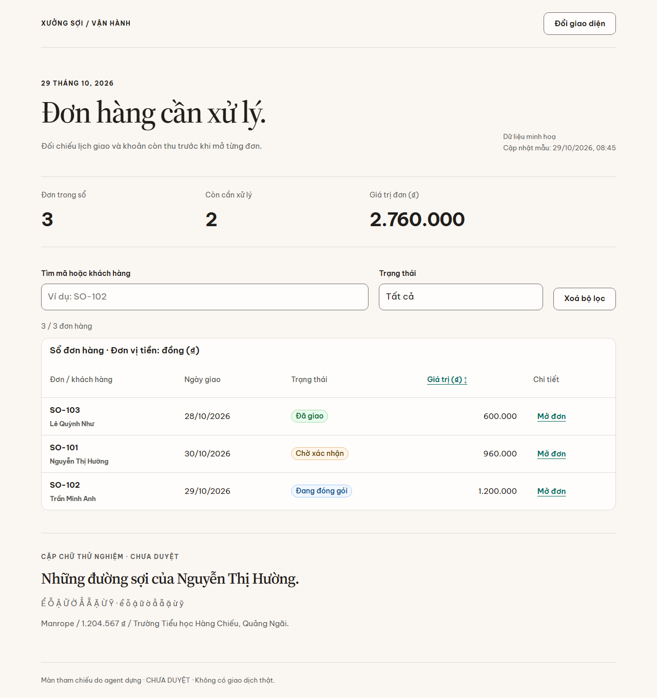
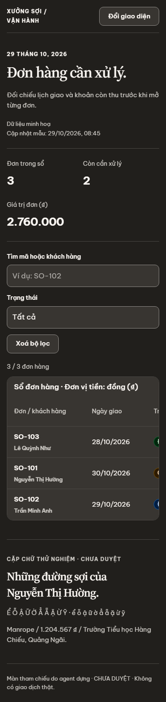
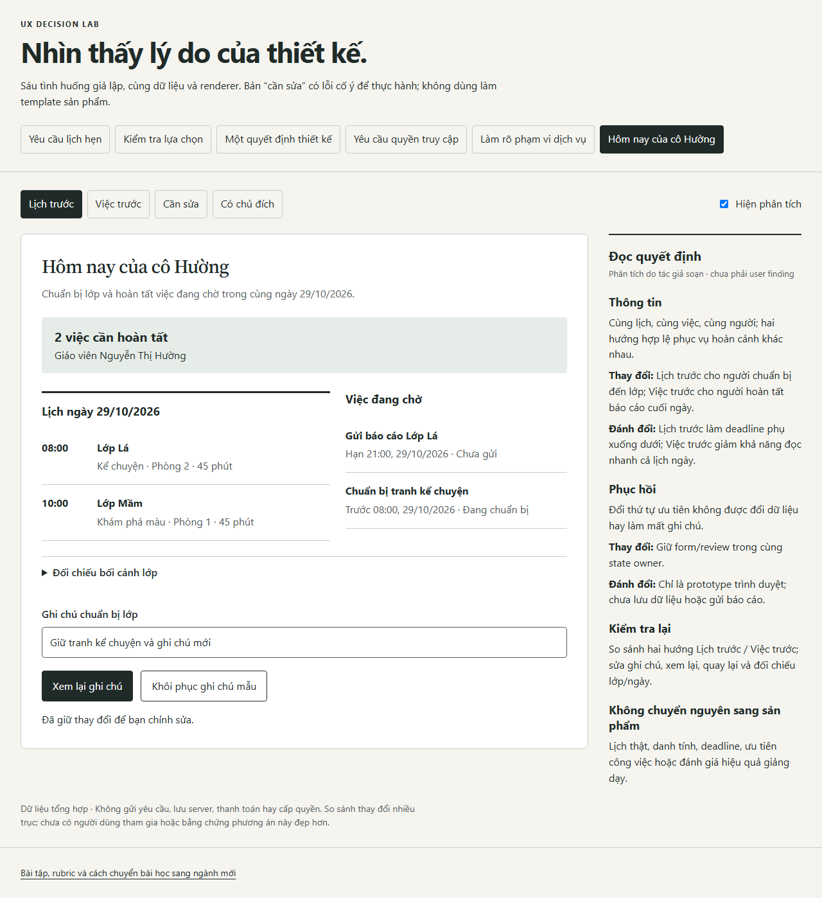
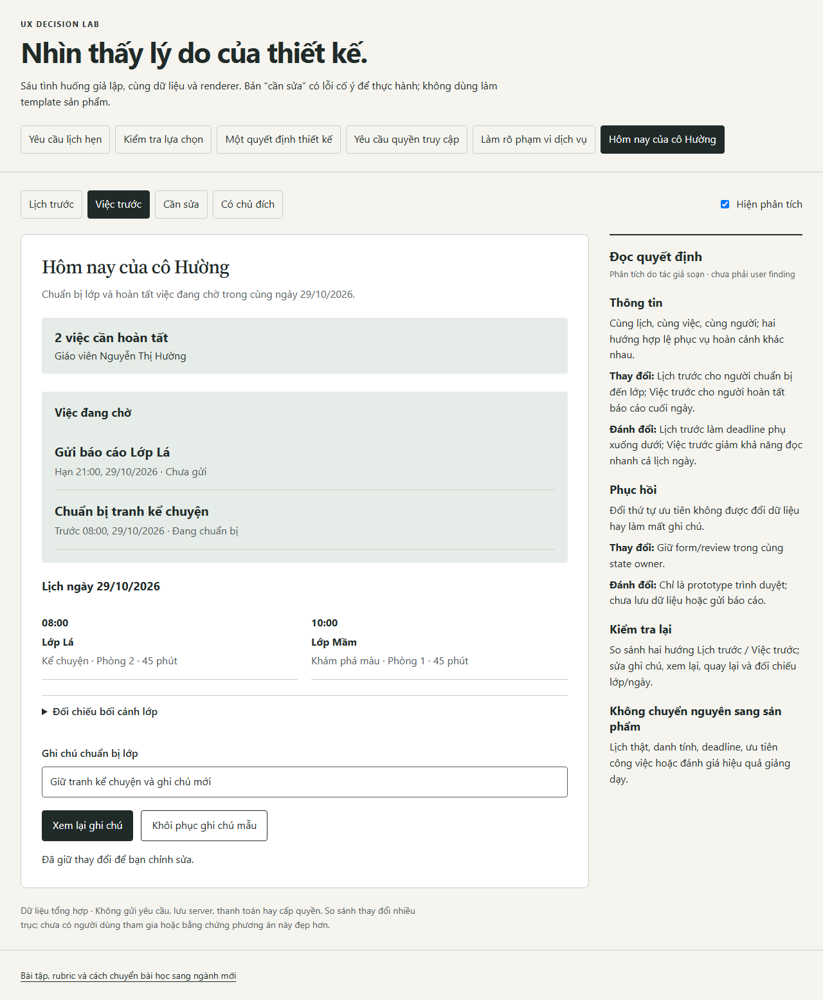

# Sổ đơn hàng và hai hướng trang chủ giáo viên

Màn tham chiếu do agent dựng, dữ liệu tổng hợp. **CHƯA DUYỆT** bởi chủ repo;
review này không phải nghiên cứu với người dùng. Không có backend hoặc giao dịch thật.

## Vì sao chọn cấu trúc này

- [Sổ đơn](index.html): tiêu đề serif cho giọng xưởng thủ công, Manrope cho số và thao tác.
  Số tiền thẳng cột, có đơn vị; trạng thái có chữ. Bảng dùng `ds-table` hiện có, không dựng lại component.
- Bộ lọc/tìm kiếm nằm sát bảng; không có kết quả thì có đường xoá bộ lọc. Nút mở đúng mã/khách hàng,
  dialog đóng bằng Escape và trả focus về nút đã mở.
- Mobile giữ bảng cuộn ngang trong vùng có tên và focus, không ép cột thành chữ vụn.
  Số tổng bên trên xuống hai hàng; không giãn card để lấp chiều cao màn.
- Giữ nhãn dữ liệu minh hoạ và thời điểm mẫu vì chúng giúp tránh hiểu nhầm số liệu hiện tại.

## Hai hướng đều khả thi, cùng một màn

Mở [decision-lab](../../../skills_UIUX/visual-design-direction/examples/decision-lab/index.html)
qua HTTP rồi chọn tình huống “Hôm nay của cô Hường”.

**Lịch trước:** lịch hai lớp chiếm cột chính, việc chờ ở cột phụ. Hợp với giáo viên chuẩn bị đến lớp,
cần thấy mốc tiếp theo và phòng. Đánh đổi: deadline báo cáo ít nổi hơn.

**Việc trước:** việc chờ đứng đầu thành danh sách quyết định, lịch thu thành khối tham chiếu phía dưới.
Hợp với cuối ngày khi mục tiêu là hoàn tất báo cáo. Đánh đổi: lịch cả ngày không được đọc trước.

Cả hai giữ cùng tên lớp, ngày, hai việc, ghi chú và đường xem lại/Back. Khác thứ tự đọc,
tỉ trọng và cấu trúc thông tin; không dùng đổi màu để giả làm hai hướng.

## Bằng chứng và giới hạn

`review/browser-report.json` có hash source/ảnh, viewport, theme, engine và kết quả từng phép thử.
Chạy lại: `NODE_PATH=<Playwright và axe-core> node design-system/scripts/capture-data-table.cjs`.
Lượt hiện tại kiểm Chromium ở 320/390/1280 px, sáng/tối: lọc, rỗng/khôi phục, sắp xếp bằng Enter,
mở đúng đơn, Escape/trả focus, Back giữ ghi chú, tải font local, console/tài nguyên, axe và reflow chữ lớn.

FontTools kiểm cmap tiếng Việt và ₫ của chính binary đóng gói. Browser kiểm font đã tải và tiếp tục
dùng khi offline; chưa chứng minh chất lượng trên mọi thiết bị hoặc mọi hệ điều hành.
Chưa kiểm screen reader, native, người dùng thật, persistence hay backend: `UNKNOWN`.
Chưa được chủ repo duyệt art direction; không gọi đây là “gold đã duyệt”.
