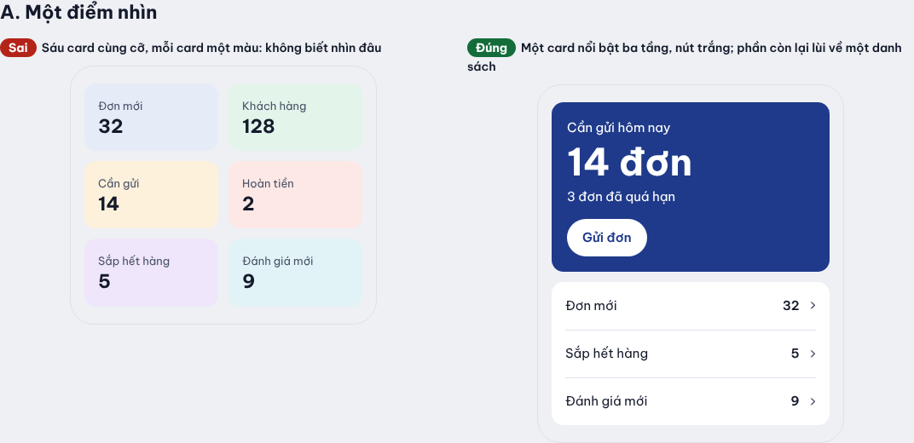
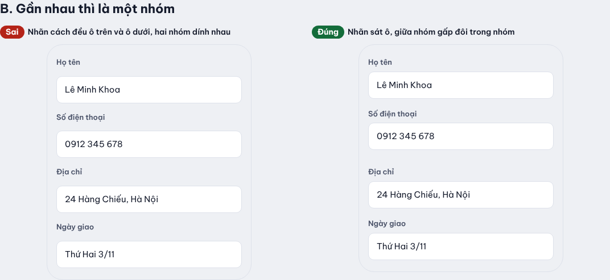
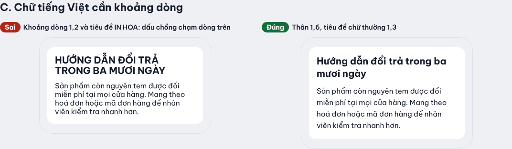
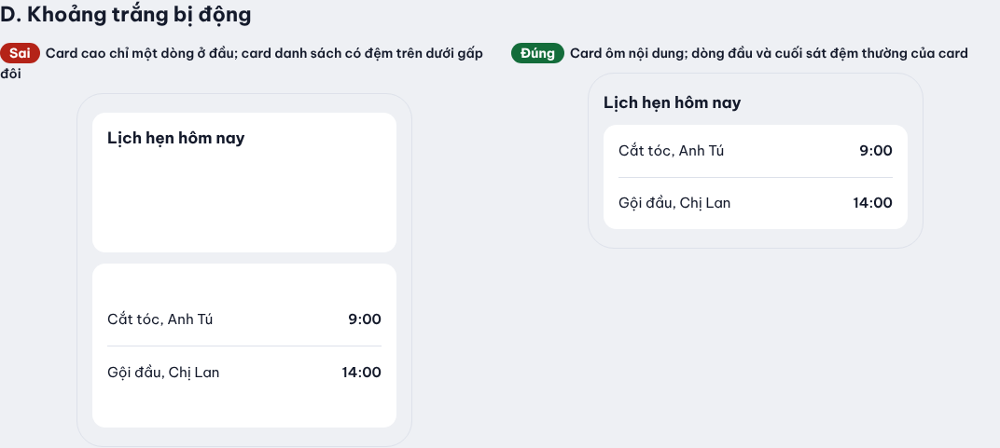
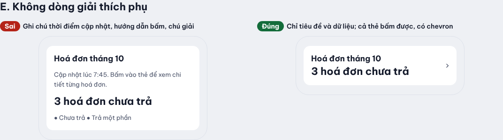
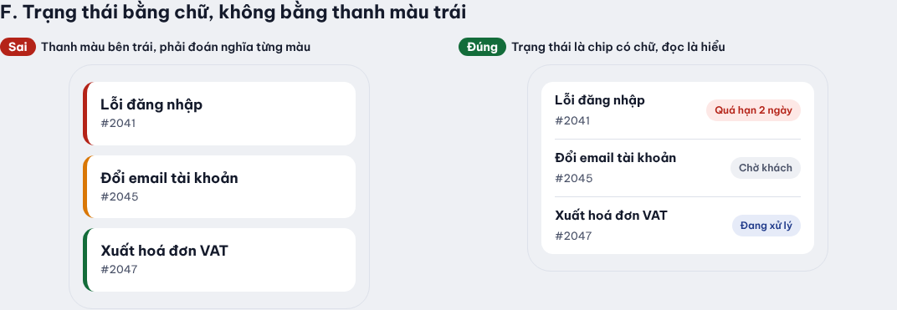
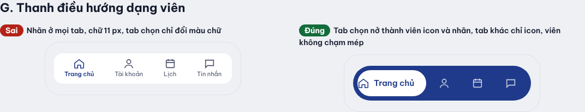
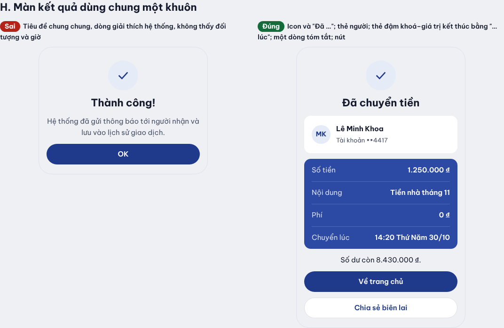
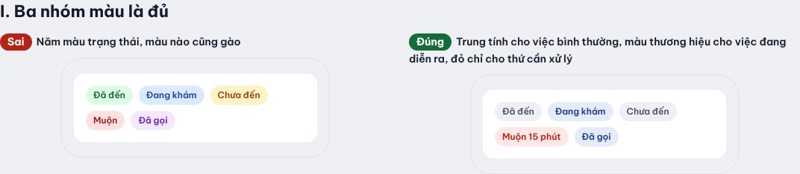

# Ví dụ Sai và Đúng

Mỗi mục là một cặp màn nhỏ, mỗi cặp một lĩnh vực khác nhau (bán hàng, giao hàng, bài viết, lịch hẹn, hoá đơn,
hỗ trợ khách hàng, ngân hàng, phòng khám), cho một nguyên tắc trong `foundations/` hoặc một quy tắc trong
[`TASTE.md`](../../TASTE.md). Nhìn ảnh trước, đọc chữ sau. Nguồn: [`index.html`](index.html); chụp lại bằng
`NODE_PATH=<thư mục có playwright> node foundations/examples/capture.cjs`.

Các cặp này do agent dựng để minh hoạ quy tắc chủ repo đã nêu, **chưa phải màn chủ repo duyệt là đẹp**.
Màn bên "Sai" cố tình vi phạm, nên trang này không chạy qua `taste-check`.

| Mục | Nguyên tắc | Trang nền |
|---|---|---|
| A | Một điểm nhìn, phần còn lại lùi về | [gestalt-and-hierarchy](../gestalt-and-hierarchy.md) |
| B | Gần nhau thì là một nhóm | [gestalt-and-hierarchy](../gestalt-and-hierarchy.md) |
| C | Chữ tiếng Việt cần khoảng dòng | [typography-vietnamese](../typography-vietnamese.md) |
| D | Khoảng trắng bị động; card danh sách sát đệm | [layout-and-density](../layout-and-density.md) |
| E | Không dòng giải thích phụ | TASTE "Chữ trên màn" |
| F | Trạng thái bằng chữ, không bằng thanh màu trái | TASTE "Card" |
| G | Thanh điều hướng dạng viên | [illustration-and-imagery](../illustration-and-imagery.md), TASTE |
| H | Màn kết quả dùng chung một khuôn | TASTE "Luồng và hành động" |
| I | Ba nhóm màu là đủ | [color-oklch](../color-oklch.md) |

## A. Một điểm nhìn

Sai: sáu số cùng cỡ, sáu màu nền, không có câu trả lời cho "hôm nay làm gì". Đúng: một card nổi bật ba tầng
(nhãn, số, ngữ cảnh) và nút trắng; các số còn lại gom vào một card danh sách, cùng màu, có chevron.

## B. Gần nhau thì là một nhóm

Nhãn sát ô của nó (6 px), giữa các ô trong nhóm 16 px, giữa hai nhóm 28 px. Không cần khung hay màu để nhóm.

## C. Chữ tiếng Việt cần khoảng dòng

Ở 1,2 dấu chồng ("Ướ", "Ổ") chạm dòng trên; chữ in hoa làm tiêu đề cao và khó đọc. Thân 1,6, tiêu đề chữ thường 1,3.

## D. Khoảng trắng bị động

Card cao 150 px chỉ có tiêu đề là khoảng trắng bị động. Tiêu đề vùng đặt ngoài card; card danh sách để dòng đầu
và cuối sát đệm thường, không đệm gấp đôi.

## E. Không dòng giải thích phụ

Bỏ "Cập nhật lúc…", "Bấm vào thẻ để…" và chú giải. Cả thẻ bấm được thì chevron đã nói điều đó.

## F. Trạng thái bằng chữ

Thanh màu trái bắt người dùng nhớ nghĩa từng màu. Chip có chữ ("Quá hạn 2 ngày") nói luôn.

## G. Thanh điều hướng dạng viên

Tab đang chọn nở thành viên có icon trái, nhãn phải; tab khác chỉ icon, nhãn ẩn cho trình đọc màn hình.
Viên không chạm mép thanh. Không chữ nào dưới 12 px.

## H. Màn kết quả dùng chung một khuôn

Khuôn: icon và tiêu đề "Đã …" (không dòng phụ) → thẻ trắng có người (avatar, tên, mã) → thẻ nền đậm (sáng hơn nút
chính một chút) với các dòng khoá–giá trị, dòng cuối "… lúc" → một dòng tóm tắt kết quả → nút. Không dòng
"đã thông báo cho…".

## I. Ba nhóm màu là đủ

Trung tính cho việc bình thường, màu thương hiệu cho việc đang diễn ra, đỏ chỉ cho thứ cần xử lý. Màu nào cũng
đi kèm chữ.

## Màn chủ repo đã duyệt

Chưa có. Khi chủ repo gửi màn đẹp, mỗi màn vào đây với ảnh, một câu vì sao đẹp và nguyên tắc nó minh hoạ. Các màn
này đứng trên mọi ví dụ do agent dựng và mọi tham khảo ngoài.
