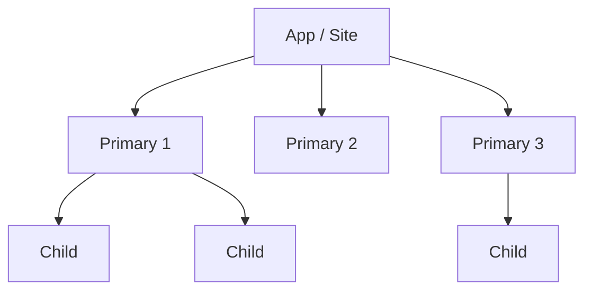

# IA and sitemap

## Navigation model

**Chosen model:** tab bar / top nav / hub + primary action / stepper / hierarchy + search / contextual
**Reason (tied to top-task frequency):**

## Structure

## Label table

| Label shown | Contains | User words it must match | Source of wording | Risk of confusion |
|---|---|---|---|---|
| | | | research / search terms / HYPOTHESIS | |

## Placement rules

| Task | Rank | Where it lives | Reachable in N taps | Persistent / contextual / hidden |
|---|---|---|---|---|

Rules: frequent tasks never hidden; labels in user language; one home per concept (no duplicate destinations with different names).

## Validation

- Tree test or card sort planned? yes / no / UNKNOWN
- Tasks for tree test (findability):
