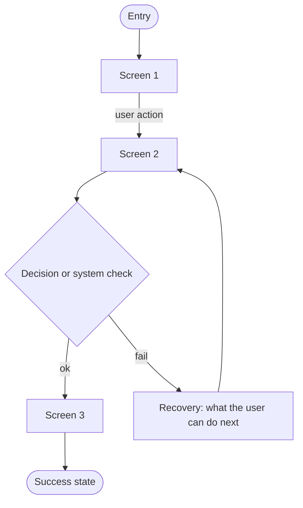

# User flow: <top task name>

**Job:** J#
**Entry points:** cold open / deep link / notification / search / shared link / return after interruption
**Success signal:**

## Flow

Notation: `([ ])` entry/end, `[ ]` screen, `{ }` decision, `R#` recovery node.

## Path inventory

| Path | Covered? | Ends in |
|---|---|---|
| Happy path | yes / no | success |
| Alternative (returning user / other entry) | | |
| Failure: invalid input | | recovery R# |
| Failure: empty / no result | | recovery R# |
| Failure: network / permission / timeout | | recovery R# |

## Step budget

Screens: __ Decisions: __ Typed fields: __
Over budget? Reason or simplification:

## Open questions

-
